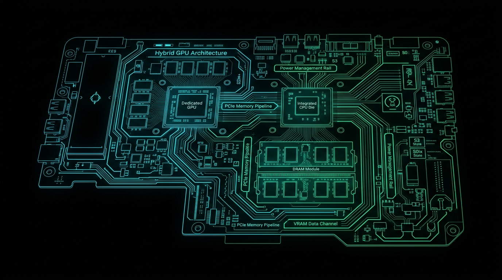
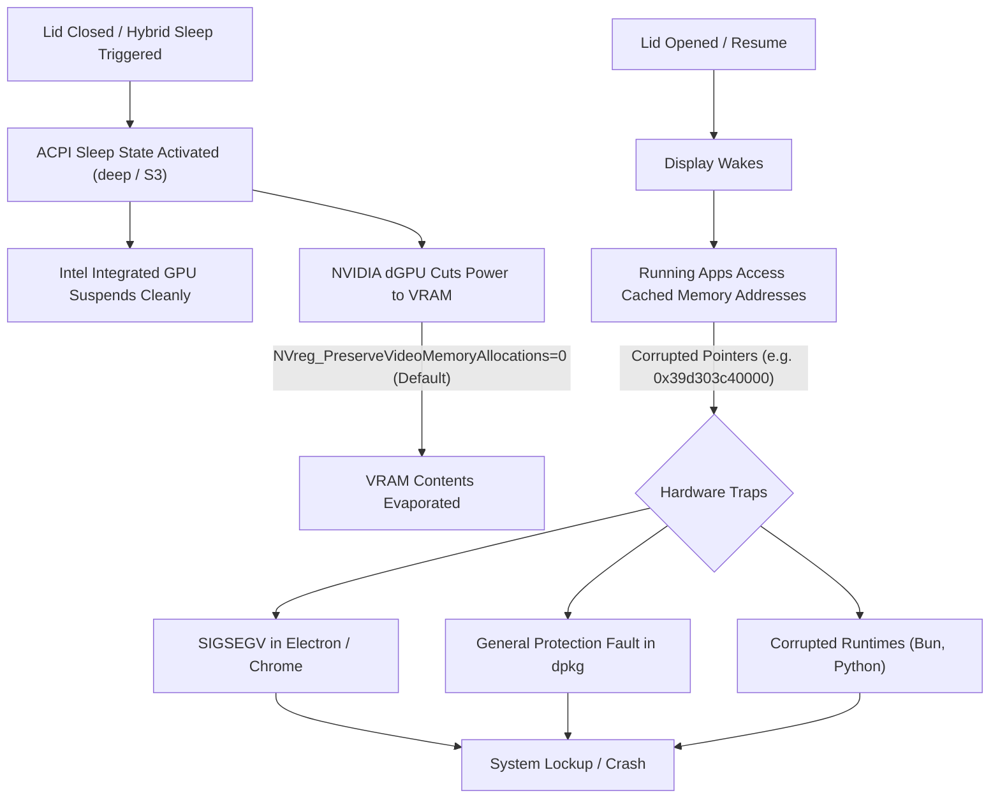

# Kali Linux System Maintenance & Crash Recovery Toolkit 🛡️⚡

[](https://www.kali.org/)
[](https://www.gnu.org/software/bash/)
[](https://www.nvidia.com/)
[](https://opensource.org/licenses/MIT)
[]()

> Automated kernel recovery, hybrid GPU sleep stabilization, memory cleanup, and rolling release synchronization suite for Kali Linux.



---

## 📌 Table of Contents
- [The Problem: Hybrid Sleep Crash & VRAM Desync](#-the-problem-hybrid-sleep-crash--vram-desync)
- [Architecture & Failure Cascade](#-architecture--failure-cascade)
- [Toolkit Overview](#-toolkit-overview)
  - [1. `fix-all` — System Recovery & Permanent Kernel Hardening](#1-fix-all--system-recovery--permanent-kernel-hardening)
  - [2. `fix-apps` — Non-Destructive RAM & Cache Cleaner](#2-fix-apps--non-destructive-ram--cache-cleaner)
  - [3. `update-all` — Complete Rolling Release Updater](#3-update-all--complete-rolling-release-updater)
- [Installation & Quick Start](#-installation--quick-start)
- [How It Works: Technical Deep Dive](#-how-it-works-technical-deep-dive)
- [Verification & Testing](#-verification--testing)
- [Author & License](#-author--license)

---

## 🛑 The Problem: Hybrid Sleep Crash & VRAM Desync

On dual-GPU laptops (Intel integrated GPU + NVIDIA discrete GPU) running Kali Linux Rolling, putting the machine to **hybrid sleep or suspend** frequently results in a black screen, unrecoverable system freeze, and forced hard reboot. 

Upon reboot, user-space software is corrupted:
* **Cascading Segmentation Faults (`SIGSEGV`):** Electron apps (VS Code, Chrome, Antigravity) die on launch.
* **General Protection Faults:** `dpkg` crashes with `traps: dpkg[...] general protection fault` during package management.
* **Corrupted Runtimes:** `bun` and Python throw invalid pointer and memory alignment exceptions.
* **Shared Memory Desync:** Dead sessions leave dangling POSIX shared memory (`/dev/shm`) and semaphore handles.

---

## 🧬 Architecture & Failure Cascade

The root cause is an uncoordinated power state transition between ACPI sleep modes and NVIDIA VRAM preservation:



---

## 🛠️ Toolkit Overview

### 1. `fix-all` — System Recovery & Permanent Kernel Hardening

`fix-all` provides two distinct operational modes:

| Mode | Command | What it does |
|---|---|---|
| **Emergency Recovery** | `sudo fix-all --recover` | Clears `dpkg` locks, fixes broken packages, purges stale shared memory/semaphores, drops page caches, and cycles swap. |
| **Permanent Hardening** | `sudo fix-all --permanent` | Configures NVIDIA VRAM preservation, enables lifecycle systemd units, fixes GRUB typos, rebuilds `initramfs`, and installs system-sleep hooks. |
| **Dry Run** | `fix-all --dry-run` | Audits what actions would be performed without modifying the system. |

### 2. `fix-apps` — Non-Destructive RAM & Cache Cleaner

A safe, fast tool to reclaim memory on bloated developer workstations:
```bash
fix-apps
```
* Frees 2GB+ of reclaimable page caches via `/proc/sys/vm/drop_caches`.
* Cleans build caches: Node compile cache, npm, pip, uv, Bun, and Python `__pycache__`.
* Reaps defunct/zombie processes.
* Zero window disruption — your browser tabs and editors stay open.

### 3. `update-all` — Complete Rolling Release Updater

Correctly updates Kali Linux rolling without breaking dependencies:
```bash
sudo update-all
```
* **Full APT Upgrade:** Executes `apt-get full-upgrade` to ensure newly split or renamed dependencies are properly upgraded (unlike standard `apt upgrade`).
* **Developer Ecosystem Sync:** Self-updates `bun`, `ollama`, `rustup`, `go`, and `opencode`.
* **Automated Cleanup:** Purges obsolete `.deb` archives and orphan packages.

---

## 📥 Installation & Quick Start

### One-Line Installation

```bash
git clone https://github.com/purvanshbhatt/Cybersecurity-Research-Reports.git
cd Cybersecurity-Research-Reports/kali-maintenance-scripts
sudo cp fix-all fix-apps update-all /usr/local/bin/
sudo chmod +x /usr/local/bin/fix-all /usr/local/bin/fix-apps /usr/local/bin/update-all
```

### Apply Permanent Sleep Fix (Run Once, Then Reboot)

```bash
sudo fix-all --permanent
sudo reboot
```

---

## 🔬 How It Works: Technical Deep Dive

### 1. VRAM Preservation Across Power Down
In `/etc/modprobe.d/nvidia-power.conf`:
```ini
options nvidia-current NVreg_PreserveVideoMemoryAllocations=1
options nvidia-current NVreg_EnableS0ixPowerManagement=1
```
This instructs the NVIDIA kernel module to allocate host system memory as backing storage and write all active video memory allocations to host RAM or disk before cutting power to the dGPU.

### 2. Systemd Sleep Lifecycle Orchestration
Enables the vendor lifecycle services:
```bash
sudo systemctl enable nvidia-suspend.service nvidia-resume.service nvidia-hibernate.service nvidia-persistenced.service
```

### 3. Bootloader Parameter Hardening
Patches `/etc/default/grub`:
```ini
GRUB_CMDLINE_LINUX_DEFAULT="quiet resume=UUID=<swap-uuid> pcie_aspm=off ahci.mobile_lpm_policy=1 nvidia-drm.modeset=1 nvidia-drm.fbdev=1 ibt=off"
```
* `ahci.mobile_lpm_policy=1`: Fixes aggressive SATA sleep latency.
* `nvidia-drm.modeset=1` & `nvidia-drm.fbdev=1`: Enables direct kernel modesetting for reliable atomic display handoff.
* `ibt=off`: Mitigates Intel Indirect Branch Tracking conflicts with proprietary GPU modules.

### 4. Memory Sweeper (`/usr/lib/systemd/system-sleep/fix-all-hook.sh`)
Automatically syncs all dirty buffers to storage right before the system suspends, and re-probes NVIDIA UVM modules upon wakeup.

---

## 🔍 Verification & Testing

Verify that VRAM preservation and power management are active:

```bash
# 1. Verify VRAM preservation parameter
cat /proc/driver/nvidia/params | grep PreserveVideoMemoryAllocations
# Expected: PreserveVideoMemoryAllocations: 1

# 2. Check NVIDIA systemd units
systemctl is-enabled nvidia-suspend nvidia-resume nvidia-hibernate
# Expected: enabled (for all 3)

# 3. Check memory status
fix-apps
```

---

## 👤 Author & License

**Purvansh Bhatt**
* Security Researcher & Systems Administrator
* GitHub: [@purvanshbhatt](https://github.com/purvanshbhatt)
* Portfolio: [purvanshbhatt.github.io](https://purvanshbhatt.github.io)

This project is licensed under the **MIT License**.
