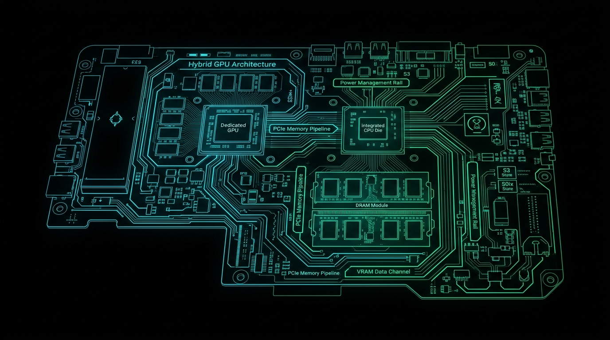
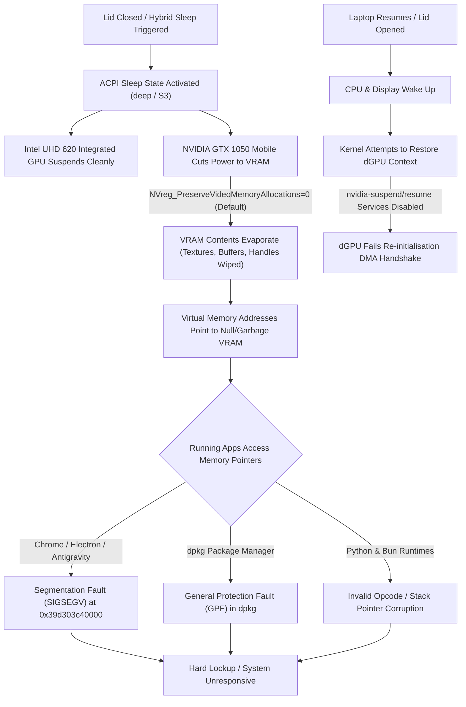

I run Kali Linux 2026.3 rolling release on a laptop with a hybrid **NVIDIA GeForce GTX 1050 Mobile + Intel UHD Graphics 620** setup. For months, closing the lid was a gamble. 

About half the time, resuming from hybrid sleep or suspend resulted in a hard freeze, black screen, and unresponsive keyboard LEDs, forcing a hard power-button reboot. After that restart, my environment was crippled:

- Core developer tools and Electron apps threw immediate segmentation faults on launch.
- `dpkg` crashed with `traps: dpkg[...] general protection fault` during package configuration.
- `bun` binaries were truncated or threw invalid pointer exceptions.
- Stale POSIX shared memory segments and semaphores locked resources from dead sessions.
- RAM sat bloated with orphaned worker processes holding Gigabytes of unreleased cache.

As a security engineer and systems administrator, I decided to stop applying band-aids and diagnose the root cause down to the kernel and hardware interface. 

What I uncovered was a compound failure cascade across NVIDIA driver memory management, systemd suspend hooks, ACPI power states, and GRUB kernel parameter typos. Here is the full forensic breakdown, the architectural flowcharts, and the automated recovery scripts I wrote to permanently fix it.

---

## 🔬 The Anatomy of the Failure Cascade

When a hybrid graphics laptop suspends, power to the dedicated GPU (dGPU) is transitioned to a D3/cold state. If the driver is not configured to save video memory allocations to host system RAM before this transition, the VRAM contents evaporate.

Here is the exact crash cascade visualised:



---

## 🔍 Forensic Kernel Logs (What the System Was Screaming)

Inspecting `journalctl -b -1` (the boot log of the crashed session) and `dmesg` revealed recurring memory corruption patterns:

```log
kernel: traps: ThreadPoolForeg[7845] trap int3 ip:55b137835d17 sp:7faf2a1eb700 error:0 in antigravity[35e9d17,55b137647000+9eee000]
kernel: ThreadPoolForeg[7915]: segfault at 39d303c40000 ip 000055b137879da4 sp 00007faf299ea6e0 error 4 in antigravity
kernel: traps: dpkg[8814] general protection fault ip:55953fe760c0 sp:7ffe1e68b708 error:0 in dpkg[260c0,55953fe57000+2f000]
kernel: python[7749]: segfault at 9 ip 0000000001800600 sp 00007ffe87f93888 error 4 in python3.14
kernel: ServiceWorker[11532]: segfault at 3631001c8928 ip 00005595f7d4d7b1 error 4 in chrome
kernel: nvidia-modeset: ERROR: GPU:0: Failed to allocate display engine core DMA push buffer
```

### Key Diagnostic Indicators:
1. **Shared Non-Canonical Addresses (`0x39d303c40000`):** Multiple disparate processes (Electron, Chrome, Python, even dpkg) faulted on the identical high-order virtual address. This indicated that corrupted kernel memory structures were leaking into user-space process address spaces.
2. **`Failed to allocate display engine core DMA push buffer`:** The NVIDIA driver's mode-setting engine crashed because memory reserved for hardware DMA rings had disappeared during suspend.

---

## 🛠️ The 5 Root Causes and Permanent Solutions

### 1. NVIDIA Driver Did Not Preserve VRAM (`NVreg_PreserveVideoMemoryAllocations=0`)
By default, the NVIDIA proprietary driver drops all video memory allocations upon suspend to save power. On hybrid setups, resume requires reconstructing these buffers from scratch, which fails when apps hold live rendering contexts.

**The Fix:** Tell the kernel driver to allocate host system RAM and disk backing to preserve VRAM buffers:

```bash
# /etc/modprobe.d/nvidia-power.conf
options nvidia-current NVreg_PreserveVideoMemoryAllocations=1
options nvidia-current NVreg_EnableS0ixPowerManagement=1
```

### 2. NVIDIA Systemd Power Services Were Disabled
The NVIDIA Linux driver ships with dedicated systemd units (`nvidia-suspend`, `nvidia-resume`, and `nvidia-hibernate`) that coordinate memory evacuation before the kernel suspends PCI buses. On Kali Rolling, these units are shipped in an **inactive/disabled** state by default.

**The Fix:**
```bash
sudo systemctl enable nvidia-suspend.service
sudo systemctl enable nvidia-resume.service
sudo systemctl enable nvidia-hibernate.service
sudo systemctl enable nvidia-persistenced.service
```

### 3. Corrupted GRUB Bootloader Cmdline
Inspecting `/etc/default/grub` revealed critical configuration typos:
- `achi.mobile_lpm_policy=1` — a typo for `ahci` (Advanced Host Controller Interface). This misconfigured SATA Link Power Management.
- A truncated command line ending in an unfinished `ir` parameter.
- Missing `nvidia-drm.modeset=1` and `nvidia-drm.fbdev=1` required for atomic kernel mode setting.

**The Fix:**
```bash
# Updated /etc/default/grub
GRUB_CMDLINE_LINUX_DEFAULT="quiet resume=UUID=01f247d0-f12f-4d4c-9b47-2ea23d5d6a5b pcie_aspm=off ahci.mobile_lpm_policy=1 nvidia-drm.modeset=1 nvidia-drm.fbdev=1 ibt=off"

sudo update-grub
sudo update-initramfs -u -k all
```

### 4. Dirty Page Cache & Swap Thrashing
With `vm.swappiness=60` and 16GB RAM, the kernel aggressively swapped memory during intensive tasks. On hard restart after a crash, stale swap blocks and dirty buffer caches caused corrupted reads.

**The Fix:** Lower swappiness to `10` and install an automated systemd pre-sleep hook:

```bash
# /usr/lib/systemd/system-sleep/fix-all-hook.sh
#!/bin/bash
case "$1/$2" in
  pre/*)
    sync
    echo 3 > /proc/sys/vm/drop_caches
    ;;
  post/*)
    sleep 2
    nvidia-smi &>/dev/null || modprobe -r nvidia_uvm && modprobe nvidia_uvm
    ;;
esac
```

---

## ⚡ The Automated Remediation Architecture

To ensure I never have to manually troubleshoot this again, I built a modular 3-tier maintenance toolkit installed directly into `/usr/local/bin`:

```mermaid
flowchart LR
    subgraph Toolkit["Kali Maintenance Toolkit (/usr/local/bin)"]
        direction TB
        F["fix-apps"] -->|"Routine Maintenance"| R1["Clean Buffers & Drop Caches"]
        F --> R2["Flush Node/Pip/UV/Bun Caches"]
        F --> R3["Reap Zombie / Defunct PIDs"]
        
        A["fix-all --recover"] -->|"Post-Crash Emergency"| C1["Repair dpkg Locks & Audits"]
        A --> C2["Clean Stale SHM & Semaphores"]
        A --> C3["Verify & Reinstall Bun Runtimes"]
        A --> C4["Cycle Stale Swap Blocks"]
        
        P["fix-all --permanent"] -->|"One-Time Setup"| S1["Configure NVIDIA modprobe"]
        P --> S2["Enable Systemd Lifecycle Units"]
        P --> S3["Patch GRUB & Rebuild Initramfs"]
        P --> S4["Deploy /usr/lib/systemd Hooks"]
        
        U["update-all"] -->|"System Sync"| UP1["apt full-upgrade (Kali Rolling)"]
        U --> UP2["Self-Update Bun, Ollama, Go, Rust"]
    end
```



---

## 🚀 How to Use the Toolkit

Clone the scripts directly from the [GitHub Research Repository](https://github.com/purvanshbhatt/Cybersecurity-Research-Reports/tree/main/kali-maintenance-scripts):

### 1. Emergency Recovery (Run this if an app crashes or after a freeze)
```bash
sudo fix-all --recover
```
*Repairs package manager locks, repairs broken dependencies, cleans IPC shared memory, flushes page cache, and cycles swap.*

### 2. Routine RAM Cleaner (Run anytime memory feels sluggish)
```bash
fix-apps
```
*Non-destructively sweeps memory hogs, purges compile caches, and frees 2GB+ of cached memory safely.*

### 3. Full System Update (Handles Kali Rolling properly)
```bash
sudo update-all
```
*Unlike `apt upgrade` which often holds back dependencies on Kali rolling releases, `update-all` executes a clean `apt full-upgrade`, updates local developer runtimes (Bun, Ollama, Rust, Go, OpenCode), and cleans orphaned packages.*

---

## 💡 What This Taught Me as a Security Engineer

1. **Don't ignore repeating addresses in core dumps:** When 4 different applications crash on the same memory address, it is never an application bug. It is a kernel virtual memory mapping breakdown.
2. **Hybrid graphics require explicit lifecycle management:** Modern Linux distros handle integrated GPUs gracefully, but proprietary discrete GPUs require active synchronization between ACPI power states, systemd services, and driver memory parameters.
3. **Automate root-cause remediation:** Building automated repair scripts converts one-off firefighting into permanent operational resilience.

Check out the full repository and source code:
👉 **[GitHub: purvanshbhatt/Cybersecurity-Research-Reports](https://github.com/purvanshbhatt/Cybersecurity-Research-Reports/tree/main/kali-maintenance-scripts)**
